  <picture>
    <source media="(max-width: 700px)" srcset="./assets/banner-mobile.svg">
    
  </picture>

`daniel@35nb` — 写 DSH 插件、鸿蒙 App，和几个自己每天要用的工具。

- **[dsh-remote-console](https://github.com/Daniel35NB/dsh-remote-console)** — 手机连电脑上的 DSH：配对、会话、流式、文件、审批。`ArkTS` `Node.js` `DRC/1` 
  PC 插件 + 鸿蒙原生 App · 自测 219/219，真机验收收尾
- **[dsh-budget-watcher](https://github.com/Daniel35NB/dsh-budget-watcher)** — 余额、单轮花费、烧钱速率，一个悬浮小窗。`JavaScript` 
  subagent 开到失控之前，至少能看见 · fork of NeutronStar714
- **[Drug-trace](https://github.com/Daniel35NB/Drug-trace)** — 药店追溯码扫码，直连码上放心。`uni-app` `Vue 3` 
  连续扫码、断网缓存、指数退避重试 · 柜台前不能卡
- **[shudu_solver](https://github.com/Daniel35NB/shudu_solver)** — 数独，多解全枚举。`Python` `Tkinter` 
  解不出来那天晚上写的
- **[TokenTracker](https://github.com/Daniel35NB/TokenTracker)** — 本地跑的 token 账本，31 个编码工具。`JavaScript` 
  fork of xiufengsun/TokenTracker

- **dsh-remote-console** — 补运行中排队、插入消息、会话导出。
- **DSH 生态** — 成本、审批、远程，一个方向往下做。

`Python` `JavaScript` `TypeScript` `Vue` `uni-app` `Node.js` `ArkTS` `Tkinter`

前端到端上，够用就写。

